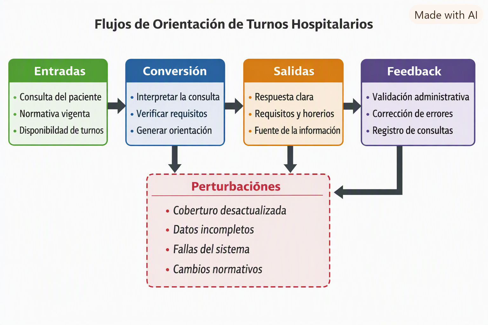

# Agente de orientación de turnos hospitalarios

## 📌 Descripción
Los pacientes necesitan reservar turnos médicos, pero la información sobre requisitos, horarios y coberturas está dispersa en distintos sistemas y documentos. Esto genera demoras, errores y consultas repetidas.

## 🎯 Objetivo
Orientar a los pacientes sobre turnos y requisitos, sin autorizar ni modificar agendas oficiales.  
El agente debe derivar a personal humano cuando la consulta exceda su alcance.

## 🧩 Modelo sistémico preliminar
- **Frontera:**  
  - Dentro: interfaz de consulta, corpus documental autorizado, reglas de cobertura, buscador de turnos, generador de respuesta.  
  - Fuera: sistema oficial de turnos, decisiones administrativas, validación médica.  
  - Área gris: acceso automático a la historia clínica vs. información aportada por el paciente (impacta en privacidad y permisos).  

- **Contexto:** pacientes, sistema de gestión hospitalaria, normativa de cobertura, personal administrativo.  

- **Sinergia:** el agente solo funciona si coordina reglas de cobertura, disponibilidad de turnos y validación humana.  

- **Recursividad:** el agente contiene subsistemas de consulta documental y validación de cobertura, pero también integra el sistema institucional de orientación y gestión de turnos.  

- **Perturbaciones:**  
  - Cobertura desactualizada  
  - Datos incompletos del paciente  
  - Caída del sistema hospitalario  
  - Cambios normativos inesperados  

- **Flujos (sistema abierto):**  
  - Entrada: consulta del paciente, normativa vigente, disponibilidad de turnos.  
  - Conversión: interpretar la consulta, verificar requisitos, contrastar con normativa, generar orientación.  
  - Salida: respuesta fundamentada con requisitos, disponibilidad y fuentes.  
  - Feedback: validación administrativa, corrección de errores, registro de consultas.  
  

## ❓ Preguntas de investigación
1. ¿Qué información puede usar el agente sin comprometer la privacidad del paciente?  
2. ¿Cómo se valida la salida para evitar errores críticos?  
3. ¿Qué ocurre cuando el agente no sabe o detecta contradicciones?  
4. ¿Qué perturbaciones externas afectan más el funcionamiento?  
5. ¿Qué decisiones requieren intervención humana obligatoria?  

---

📂 Para más detalles, ver las carpetas:  
- `01-problema/` → descripción del problema, actores y evidencia.  
- `02-modelo-sistemico/` → frontera, contexto, sinergia y recursividad.  
- `03-flujos-y-control/` → entradas, conversión, salidas, feedback y perturbaciones.  
- `04-investigacion/` → fichas y preguntas abiertas. 